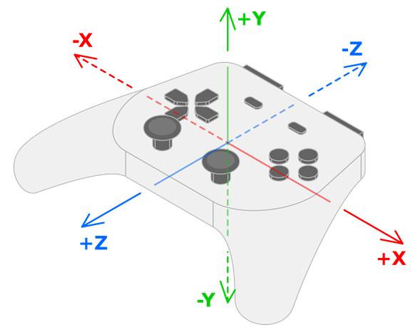

.. _doc_controller_features:

Controller features
===================

Godot supports controller-specific features that can further enhance the gameplay
experience. This page describes these features, how existing games have used them,
and how you can get started with them in Godot.

.. warning::

    These controller features are currently only supported on Windows, macOS, iOS, and Linux.

.. warning::

    Unless you specifically advertise your game as requiring specific controllers,
    remember that there is no guarantee that players will have a controller with
    any given features.

    As a result, we suggest using these features to enhance the gameplay experience
    for players whose controllers support them, without detracting from those who
    don't have controllers.

.. seealso::

    You can test your controller's advanced features in the
    `Joypads demo project <https://github.com/godotengine/godot-demo-projects/tree/master/misc/joypads>`__.

.. _doc_controller_features_led_color:

LED color
---------

Games can use the LED lights on certain controllers to subtly complement the on-screen gameplay by
providing some matching visuals in the player's hands. Here are some notable examples:

- In *Hades*, the color of the light matches the god you're receiving a boon from.
- In *Resident Evil 2*, the color of the light indicates your health (green for full, yellow for medium, red for low).
- In *Star Wars Jedi: Fallen Order*, the color of the light matches your lightsaber's color.

Use the method :ref:`Input.set_joy_light()<class_Input_method_set_joy_light>` to set the color
of a given controller's LEDs.

To determine if a given controller supports setting LED lights, use the :ref:`Input.has_joy_light()<class_Input_method_has_joy_light>`
method. The PlayStation DualShock and DualSense controllers are known to support LED lights.

The following ``_process()`` method sets the LED color according to the currently pressed button,
and turns it off if no button is being pressed:

.. code-block::

    func _process(_delta):
        var color := Color.BLACK

        if Input.is_joy_button_pressed(0, JOY_BUTTON_A):
            color = Color.BLUE
        elif Input.is_joy_button_pressed(0, JOY_BUTTON_X):
            color = Color.MAGENTA
        elif Input.is_joy_button_pressed(0, JOY_BUTTON_B):
            color = Color.RED
        elif Input.is_joy_button_pressed(0, JOY_BUTTON_Y):
            color = Color.GREEN

        Input.set_joy_light(0, color)

The following example smoothly fades the LED through hues in a loop:

.. code-block::

    var hue = 0.0

    func _process(delta):
        var col = Color.from_hsv(hue, 1.0, 1.0)
        Input.set_joy_light(0, col)
        hue += delta * 0.1

The following example makes the LED blink red three times when the south button (Cross/X on PlayStation controllers) is pressed:

.. code-block::

    var blink_tween: Tween = null

    func _process(_delta):
        var ready_to_blink = not blink_tween or not blink_tween.is_running()
        if Input.is_joy_button_pressed(0, JOY_BUTTON_A) and ready_to_blink:
            do_blink()

    func do_blink():
        if blink_tween:
            blink_tween.kill()

        blink_tween = create_tween()
        blink_tween.tween_callback(func(): Input.set_joy_light(0, Color.RED))
        blink_tween.tween_interval(0.2)
        blink_tween.tween_callback(func(): Input.set_joy_light(0, Color.BLACK))
        blink_tween.tween_interval(0.2)
        blink_tween.set_loops(3)

.. _doc_controller_features_motion_sensors:

Motion sensors (gyroscope and accelerometer)
--------------------------------------------

With motion controls, games can track the controller's physical rotation and movement.
This can be used to let the player turn the in-game camera by moving their controller, or shaking their controller to perform a special action.

There are several controller brands that have implemented gyroscope and accelerometer sensors
into their modern controllers, the biggest two being PlayStation and Nintendo.
Note that the Xbox controllers don't have motion sensors inside of them.

To check if a connected controller has motion sensors, use :ref:`Input.has_joy_motion_sensors()<class_Input_method_has_joy_motion_sensors>`.

Motion sensors are disabled by default to avoid draining the controller battery when games don't use those features.
To enable them, call :ref:`Input.set_joy_motion_sensors_enabled()<class_Input_method_set_joy_motion_sensors_enabled>`.

Note that the axes of the values that controller's motion sensors report are always relative to the controller's natural orientation.
Here's an image of the axes mapping for more clarity:

The controller's gyroscope values show rotation around their respective axes:

- the X value of the gyroscope data shows the rotation around the X axis (pitch).
- the Y value of the gyroscope data shows the rotation around the Y axis (yaw).
- the Z value of the gyroscope data shows the rotation around the Z axis (roll).

The controller's accelerometer will provide values in the following ways, respectively:

- Movement left and right are reported as **+X** and **-X**.
- Movement down and up are reported as **+Y** and **-Y**.
- Movement away from and towards the user are reported as **+Z** and **-Z**.

Gyroscope
~~~~~~~~~

A **gyroscope** is a type of sensor that detects the controller's rotation.
Here are some notable examples of gyroscope use in games:

- In *Helldivers 2*, *Horizon Forbidden West*, *Star Wars: Dark Forces Remaster*, and *Fortnite*,
  tilting the controller causes the camera to rotate accordingly ("gyro aiming").
  `This video by *Daven On The Moon* <https://www.youtube.com/watch?v=Vlfg9yku2hY>`_ demonstrates and discusses gyro aiming in more detail.
- In *Death Stranding*, BB can be soothed by rotating the controller softly.

The following example rotates an object using a controller's gyroscope sensor.
You can also access this example by taking a look at the
:ref:`Input.start_joy_motion_sensors_calibration()<class_Input_method_start_joy_motion_sensors_calibration>` documentation.

.. code-block::

    const GYRO_SENSITIVITY = 10.0

    func _ready():
        # In this example we only use the first connected joypad (id 0).
        if 0 not in Input.get_connected_joypads():
            return

        if not Input.has_joy_motion_sensors(0):
            return

        # We must enable the motion sensors before using them.
        Input.set_joy_motion_sensors_enabled(0, true)

        # (Tell the users here that they need to put their joypads on a flat surface and wait for confirmation.)

        # Start the calibration process.
        calibrate_motion()

    func _process(delta):
        # Only move the object if the joypad motion sensors are calibrated.
        if Input.is_joy_motion_sensors_calibrated(0):
            move_object(delta)

    func calibrate_motion():
        Input.start_joy_motion_sensors_calibration(0)

        # Wait for some time.
        await get_tree().create_timer(1.0).timeout

        Input.stop_joy_motion_sensors_calibration(0)
        # The joypad is now calibrated.

    func move_object(delta):
        var node: Node3D = ... # Put your object here.

        var gyro := Input.get_joy_gyroscope(0)
        node.rotation.x -= -gyro.y * GYRO_SENSITIVITY * delta  # Use rotation around the Y axis (yaw) here.
        node.rotation.y += -gyro.x * GYRO_SENSITIVITY * delta  # Use rotation around the X axis (pitch) here.

Note that before using the gyroscope's data, we must first calibrate it by calling :ref:`Input.start_joy_motion_sensors_calibration()<class_Input_method_start_joy_motion_sensors_calibration>`
and :ref:`Input.stop_joy_motion_sensors_calibration()<class_Input_method_stop_joy_motion_sensors_calibration>`.
That's because modern gyroscopes often need calibration. This is like how a weighing scale can need calibration to tell it what "zero" is.
Like a weighing scale, only a correctly calibrated gyroscope will give an accurate reading.
During calibration, the user sets the controller down on a flat surface.
The controller then determines what values its gyroscope reports when it is actually not moving at all (its "bias"),
and uses this information to make its rotation data more accurate.

See `the article on GyroWiki <http://gyrowiki.jibbsmart.com/blog:good-gyro-controls-part-1:the-gyro-is-a-mouse>`__
for information on how to use gyroscope input as a mouse.

After the controller's gyroscope has been enabled and correctly calibrated,
you can read its reported values by using :ref:`Input.get_joy_gyroscope()<class_Input_method_get_joy_gyroscope>`.

Accelerometer
~~~~~~~~~~~~~

.. warning::

    Do not use accelerometer data to find the controller's position in 3D space;
    the accelerometers in general are not precise enough for this.

An **accelerometer** is a type of sensor that detects a controller's acceleration in m/s².
For example, it can detect if the player quickly raises their controller, moves it to the side, or shakes it.

The acceleration that an accelerometer detects includes gravity by default.
To get *only* the acceleration imparted by the user, subtract gravity from the detected acceleration:

.. code-block::

    Input.get_joy_accelerometer(device) - Input.get_joy_gravity(device)

Due to how accelerometers work physically, after movement in one direction stops
they almost immediately report movement in the opposite direction.
After detecting movement in one direction, you may want to ignore further readings
for a small period of time to avoid detecting this opposite movement.

The following example prints the controller movement when it's being quickly moved by using its accelerometer.
If the sensitivity doesn't feel right for you,
you can tweak the ``THRESHOLD`` constant or you can replace it by using a different value in the code below.

.. code-block::

    var detect_accelerometer = true

    # Change to make the game detect movement at different thresholds.
    # With a lower value, smaller movements will be detected, and with a
    # larger value, only big movements will be detected.
    const THRESHOLD = 10.0

    func _ready():
        # In this example, we only use the first connected joypad (ID 0).
        if 0 not in Input.get_connected_joypads():
            return

        if not Input.has_joy_motion_sensors(0):
            return

        # We must enable the motion sensors before using them.
        Input.set_joy_motion_sensors_enabled(0, true)

    func _process(delta):
        if Input.has_joy_motion_sensors(0):
            accelerometer_example()

    func accelerometer_example():
        if not detect_accelerometer:
            return

        var acceleration = Input.get_joy_accelerometer(0) - Input.get_joy_gravity(0)
        if acceleration.length() > THRESHOLD:
            if acceleration.x > THRESHOLD:
                print("Moved left")
            elif acceleration.x < -THRESHOLD:
                print("Moved right")
            if acceleration.y < -THRESHOLD:
                print("Moved up")
            elif acceleration.y > THRESHOLD:
                print("Moved down")
            if acceleration.z < -THRESHOLD:
                print("Moved closer to the player")
            elif acceleration.z > THRESHOLD:
                print("Moved away from the player")

            # After detecting movement in one direction, the accelerometer sensor
            # will briefly report movement in the opposite direction, even though the controller only moved once.
            # So we need to ignore these reported values for a short amount of time.
            detect_accelerometer = false
            await get_tree().create_timer(0.5, false).timeout
            detect_accelerometer = true

.. _doc_controller_features_touchpad:

Touchpad
--------

Games can use the touchpad on certain controllers to provide an additional way
to interact with the game. This is mainly used for navigating menus, controlling
in-game cursors, or interacting with maps.

Here are some notable examples of touchpad use in games:

- In *Deep Rock Galactic*, the touchpad can be swiped in different directions to
  change weapons/equipment. You can use it to rotate the 3D map as well.
- In *Final Fantasy XIV*, the touchpad can be used as a mouse pad.

Touchpads can support multitouch input, with the maximum number of simultaneous
touch points varying depending on the controller. Some controllers may also
feature multiple touchpads altogether. For example, the DualShock 4, DualSense,
and DualSense Edge all support reporting 2 simultaneous touch points, which
allows for two-finger pan/pinch gestures to be implemented. The Steam Controller (2026)
features two touchpads, but only one finger is reported per touchpad (additional
fingers will average out the touch position).

Pressing the touchpad sends a standard button press event, which is recognized
as :ref:`JOY_BUTTON_TOUCHPAD <class_@GlobalScope_constant_JOY_BUTTON_TOUCHPAD>`.
In games, pressing the touchpad is generally used to open/close a map menu.

Use the method :ref:`Input.get_joy_num_touchpads() <class_Input_method_get_joy_num_touchpads>`
to detect whether touchpad input is supported by the controller. If supported,
the reported number will be greater than ``0``.

To get the position of touchpad presses, use
:ref:`Input.get_joy_touchpad_finger_position() <class_Input_method_get_joy_touchpad_finger_position>`
with the finger IDs returned by
:ref:`Input.get_joy_touchpad_fingers() <class_Input_method_get_joy_touchpad_fingers>`.
The coordinates are given in normalized space, with ``(0, 0)`` representing the
top-left corner and ``(1, 1)`` representing the bottom-right corner of the
touchpad. If an invalid touchpad or finger ID is used, the method returns ``(-1, -1)``.
Keep in mind the touchpad generally does not have a square aspect
ratio, so make sure to account for this when interpreting touchpad coordinates.

Some touchpads can also return the pressure applied with each finger using
:ref:`Input.get_joy_touchpad_finger_pressure() <class_Input_method_get_joy_touchpad_finger_pressure>`.
The Steam Controller (2026) supports reporting touchpad pressure, but the
DualShock 4, DualSense, and DualSense Edge do not support reporting
touchpad pressure (it will always be reported as ``1.0``).

This example code resizes a sprite according to a two-finger pinching gesture
performed on the touchpad:

.. code-block::

    @onready var sprite = $Sprite

    var last_distance = 0.0

    func _process(delta):
        # We only use joypad 0 in this example and it needs to have at least one touchpad.
        if 0 not in Input.get_connected_joypads() or Input.get_joy_num_touchpads(0) == 0:
            return

        # Get the current fingers on the touchpad.
        var fingers = Input.get_joy_touchpad_fingers(0)

        # If both fingers are on the touchpad, calculate the size difference since the last frame.
        if 0 in fingers and 1 in fingers:
            var pos1 = Input.get_joy_touchpad_finger_position(0, 0)
            var pos2 = Input.get_joy_touchpad_finger_position(0, 1)
            var distance = pos1.distance_to(pos2)
            if last_distance != 0.0:
                var size_multiplier = distance / last_distance
                sprite.scale *= size_multiplier
            last_distance = distance
        else:
            # Otherwise, don't check the distance, since we can't calculate it from no fingers or just one finger.
            last_distance = 0.0

.. note::

    On some operating systems, using the touchpad will also automatically move
    the system mouse cursor, and pressing the touchpad will send a left mouse
    button click.

    This behavior cannot be controlled by Godot, and may lead to the mouse cursor leaving
    the game window when playing in windowed mode. This can be countered by setting the
    mouse mode to :ref:`Input.MOUSE_MODE_CAPTURED <class_Input_constant_MOUSE_MODE_CAPTURED>`
    or :ref:`Input.MOUSE_MODE_CONFINED_HIDDEN <class_Input_constant_MOUSE_MODE_CONFINED_HIDDEN>`,
    so that touchpad presses can't accidentally cause the game window to lose focus.
